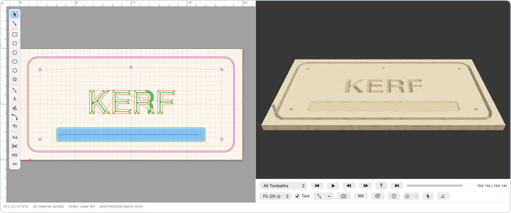
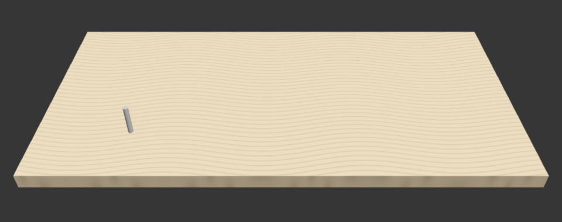
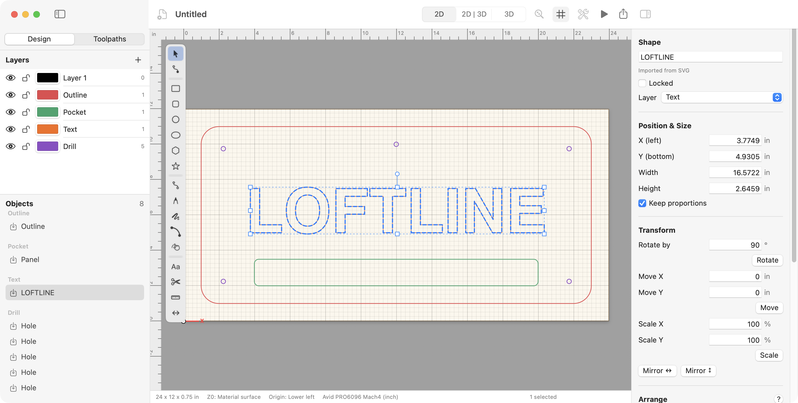
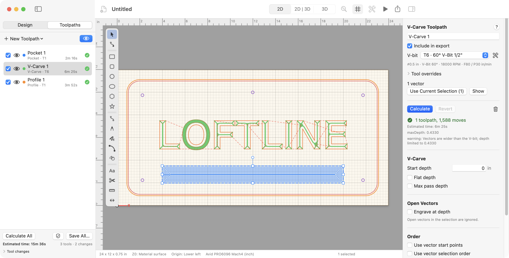
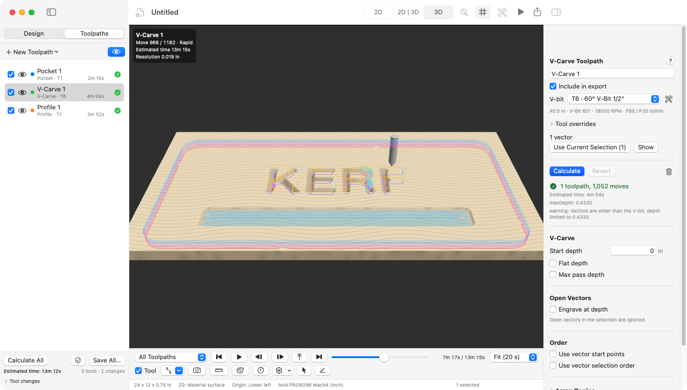
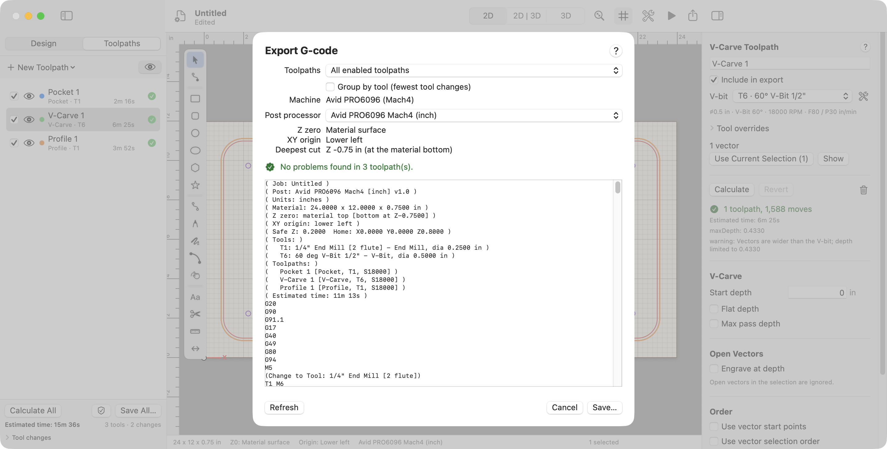

# Kerf

**CAD/CAM for CNC routers, native on the Mac.** Draw or import a design, set up toolpaths, watch the
cut in 3D, and export G-code that is checked before it reaches the machine.

Kerf is built for the Avid CNC PRO6096 (Mach4) and replaces VCarve Pro for that machine. It covers 2D,
2.5D and basic 3D routing on Apple Silicon Macs with macOS 14 or later.

<picture>
  <source media="(prefers-color-scheme: dark)" srcset="docs/images/hero-dark.png">
  
</picture>

## See the cut before the router does



The 3D preview removes material move by move and estimates the run time. This is the sample sign
(`samples/sign.kerf`): a pocket, V-carved letters, five drilled holes, then the cut-out with tabs.
Kerf estimates about 15 minutes of machine time.

## From design to G-code

<table>
  <tr>
    <td width="50%" valign="top">
      <br>
      <b>1. Draw or import.</b> Shapes, a Bézier pen, text in any installed font, node editing,
      booleans and offsets. Import SVG, DXF, EPS, AI and PDF vectors, trace images, or bring in
      STL/OBJ models.
    </td>
    <td width="50%" valign="top">
      <br>
      <b>2. Set up toolpaths.</b> Profile, pocket, drilling, V-carve, inlay, fluting, texture and 3D
      relief. Each one is drawn over the design as soon as it is calculated.
    </td>
  </tr>
  <tr>
    <td width="50%" valign="top">
      <br>
      <b>3. Preview in 3D.</b> Play, scrub or step through the job one move at a time, with time
      estimates. Measure the stock, and draw or select vectors in the 3D view.
    </td>
    <td width="50%" valign="top">
      <br>
      <b>4. Export checked G-code.</b> The Export sheet names the post, Z zero and deepest cut. A
      built-in validator flags risky moves before you save.
    </td>
  </tr>
</table>

## Highlights

- **172 of 196 VCarve Pro features**, including every one marked essential (P1). Status is tracked
  in [docs/PARITY.md](docs/PARITY.md).
- **Pre-flight checks.** Export warns you when a through cut has no tabs and the part would come loose.
- **Numbers that follow the job.** Fields accept expressions and document variables
  (`=thickness/2`, `1/4in`), and a through cut follows the material thickness when it changes.
- **Production runs.** True-shape nesting across sheets, production plates (one design per CSV row),
  and tiled G-code for jobs bigger than the bed.
- **Gadgets.** JavaScript add-ons that draw vectors and set up toolpaths (Gadgets > Gadget API Reference).
- **A real Mac app.** SwiftUI and AppKit, light and dark mode, and Finder thumbnails for `.kerf` files.

<details>
<summary><b>Full feature list</b></summary>

- **Design:** import SVG (incl. text and embedded images), DXF, EPS, AI and PDF vectors, tracing
  images (JPG/PNG/BMP/TIF/GIF/WebP) and STL/OBJ/COLLADA models (or their parts as flat outlines);
  browse your own clipart folders; export SVG, DXF, PDF, EPS and AI. Job notes are saved with the file.
  Jobs can be two-sided or span several material sheets, start from saved templates, and numeric
  fields accept expressions and linked document variables (`=thickness/2`, `1/4in`). Drawing tools include shapes,
  polylines, Bézier pen, text in any installed font, node editing, transforms, align/distribute,
  booleans, offset, layers, snapping and undo/redo. **Gadgets** (Gadgets menu) are JavaScript
  add-ons that draw vectors and set up toolpaths; see Gadgets > Gadget API Reference.
- **Toolpaths:** Profile (tabs, ramps, leads, last pass, start point, cut order), Pocket (offset/raster,
  several clearance tools), Drilling (peck), Hole Milling (helical bores and threads), V-Carve, Photo
  V-Carve, Prism, Quick Engrave, Chamfer, V-bit and straight-wall Inlay, Fluting, Texture, Moulding and
  3D relief (roughing + finishing, rest machining, two-sided, projection onto the model). Toolpaths can
  be merged, saved as templates by layer, and checked against keep-out zones; a tool database holds
  folders, per-material feeds and a feeds calculator. Toolpaths > Preview G-code File… shows another job's G-code.
- **Layout:** true-shape nesting with overflow onto extra sheets, clamp and fixture keep-out
  zones, part labels, production plates (one design repeated per CSV row with `{Field}` text),
  a printable job sheet, material and bed checks, and tiled G-code for jobs
  larger than the bed (Design > Layout, File > Export Job Sheet…, Toolpaths > Save Tiled G-code…).
- **Preview and output:** 2D overlay, 3D material-removal simulation and time estimates, and
  printing of the 2D design. A
  data-driven post (JSON profiles) ships with Avid Mach4 inch/mm and Generic GRBL (mm), and output
  goes through a built-in G-code validator. The 2D and 3D views can be shown side by side, and
  File > Recover Unsaved Work… restores autosaved work after a crash.

Feature status against VCarve Pro is tracked in [docs/PARITY.md](docs/PARITY.md) (196 features: 172 done,
7 partial, 17 missing, every P1 item done). [TESTING.md](TESTING.md) §3 walks through what is new since the
first test build.

</details>

## Machine safety

Kerf drives a real 60 × 96 in router, so G-code is treated as safety-critical.

- Every program goes through the G-code validator before it is saved.
- The post's output is pinned by golden files: `samples/sign.kerf` must post byte-for-byte to
  `samples/sign.tap`.
- Programs retract to safe Z before XY rapids. Keep-out zones and the move home are checked on export.
- Before cutting real material, follow the air-cut procedure in [TESTING.md](TESTING.md).

## Build and run

Requires an Apple Silicon Mac on macOS 14+ with Swift 6 (Command Line Tools are enough;
Xcode works too). Install the tools with `xcode-select --install` if `swift --version` fails.

```sh
git clone https://github.com/seanperkins/kerf.git && cd kerf
scripts/bundle.sh && open dist/Kerf.app
```

The bundle is ad-hoc signed, so macOS treats a copy downloaded from elsewhere as unverified.
A locally built one opens normally. The Welcome window has a button that opens the sample sign, and
Help > Kerf Help (⌘?) has a topic for every form.

```sh
scripts/build.sh            # debug build
scripts/test.sh             # swift-testing suite
scripts/bundle.sh           # release build → dist/Kerf.app (ad-hoc signed)
scripts/run.sh              # debug bundle + launch
```

## How it's built

- **Coding agents in parallel workstreams.** Each workstream owned its own folders
  ([docs/OWNERSHIP.md](docs/OWNERSHIP.md)) and logged its design choices in
  [docs/DECISIONS.md](docs/DECISIONS.md). [AGENTS.md](AGENTS.md) holds the rules they work by.
- **SwiftPM only.** It builds with the Command Line Tools, with no Xcode project. There are five modules:
  `CGeom` (vendored Clipper2 and Boost.Polygon Voronoi), `CADCore`, `CAMCore`, `PostCore` and the
  `KerfApp` itself.
- **Over 1,000 tests** in swift-testing, including the golden G-code above.
- **A UI harness.** `scripts/ui.sh` drives the app through a scripted scenario and saves each window as
  a PNG with its accessibility tree, in light or dark mode (see [docs/UI-HARNESS.md](docs/UI-HARNESS.md)).

## More

- [TESTING.md](TESTING.md): guided test and the safe air-cut procedure.
- [docs/PARITY.md](docs/PARITY.md): feature status against VCarve Pro.
- [docs/DECISIONS.md](docs/DECISIONS.md): design decisions.
- [THIRD_PARTY.md](THIRD_PARTY.md): vendored Clipper2 and Boost.Polygon.
